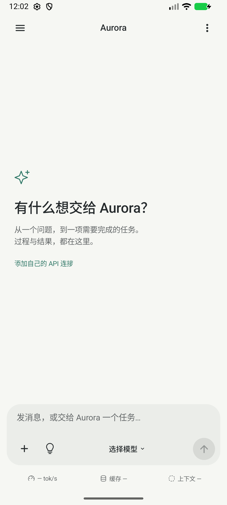
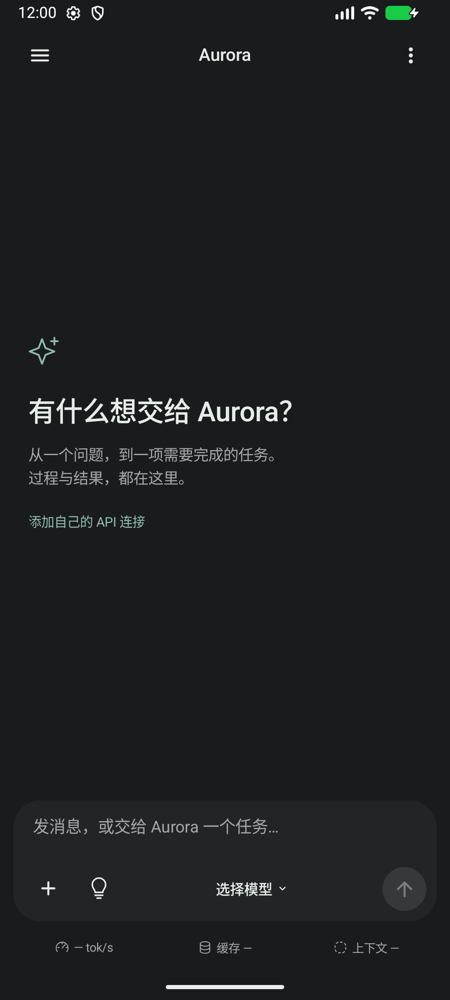
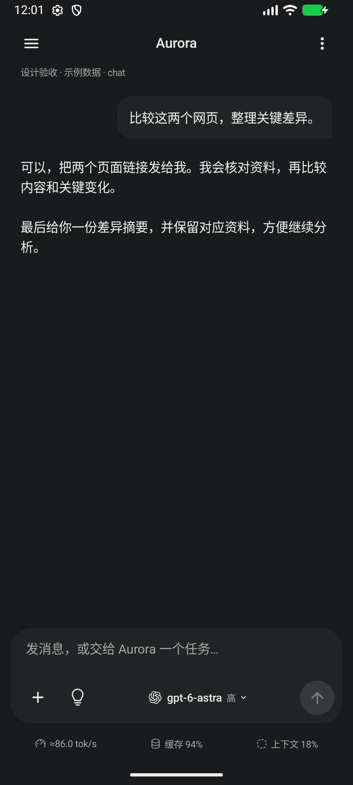
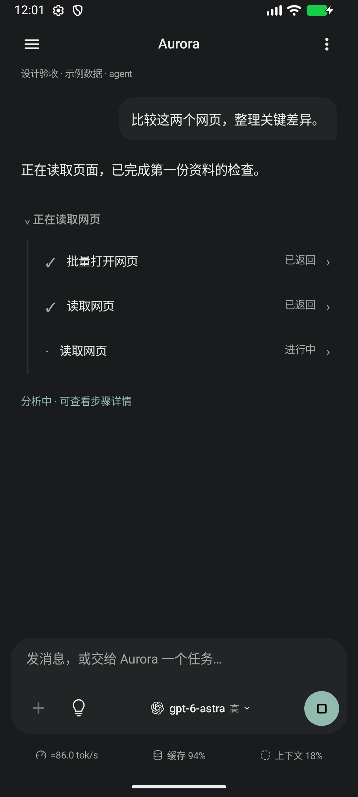

# 已确认的聊天界面修订 · 0.1.5

用户确认交互预览，补充要求“思考用灯泡”。此次修改沿用 Kotlin/Compose 与既有数据、工具后端，没有引入 UI 框架或新的运行依赖。

[已确认的交互预览源文件](assets/approved-chat-interactive.html)保留布局与比例，灯泡修订已同步归档；它是示例设计，不能作为运行证据。

## 落地内容

- 单层 25dp 圆角输入区，移除模型选择的独立边框；模型标识、准确型号和思考等级使用轻量文字排列。窄屏由剩余宽度约束，型号过长省略而不挤出发送按钮。
- 思考控件为轮廓灯泡；思考选项使用底部面板，仍遵循实际连接支持的等级和已有切换缓存提示。
- 速度、缓存、上下文在框外，带统一线条图标。点击在输入区上方原位展开，再次点击或返回收起，不打开居中弹窗。
- 左对齐空白页、较轻顶栏、无助手头像气泡、柔和用户消息背景。原 Aurora 启动图标保留。
- 右上会话工具使用同一底部面板风格，保留新会话、本会话文件和浏览器；抽屉没有新建按钮。
- 工具执行使用可折叠的步骤线，进行中自动展开，可逐项查看有界结果和调用 ID。显示“已返回”不代表任务业务成功。
- 表面色更中性，保留用户配色与深浅偏好；扩展对比度检查到输入区实际背景，修复极端自定义鲜明配色下次要文字不足 4.5:1 的问题。

底部面板生命周期遵循 [Android 官方 Compose 文档](https://developer.android.com/develop/ui/compose/components/bottom-sheets)，关闭后移出组合。没有新增第三方样式库。

## 截图与验收边界

ChatReviewActivity 只在 debug 源集中，复用正式 ChatHeader/ChatBody/ChatComposer/ToolActivity，画面明确显示“设计验收 · 示例数据”。只提供内存中的网页任务记录，不调用模型、Root 或存储，不增加正式发布版入口。示例代表布局，不是模型/抓包/逆向能力的验收。

普通主页截图来自实际 MainActivity。对话与执行中截图来自上述固定示例。APK 分析不是当前已实现工具，因此实际截图改用现有浏览器工具名称，避免虚构执行能力。

本轮仅模拟器验收；按用户要求暂不连接真机。真实 API、缓存最优策略、Root 工具、Markdown 与后台执行未因此完成。

## 实际 Android 截图

| 实际主页 · 浅色 | 实际主页 · 深色 |
| --- | --- |
|  |  |

| 对话布局 · 明确标注示例 | 执行步骤 · 明确标注示例 |
| --- | --- |
|  |  |

[浅色执行布局](assets/chat-015/agent-light.png) · [展开结果](assets/chat-015/tool-detail-dark.png) · [原位缓存详情](assets/chat-015/cache-dark.png) · [紧凑模型选择](assets/chat-015/model-picker.png)

验收：核心 45 项；API 37 模拟器设备测试 18 项、独立进程浏览器恢复 1 项通过。debug/release/lint 通过；2 项既有资源警告仍在。手动检查主界面、会话菜单、带模型图标的紧凑选择、灯泡等级切换、工具结果展开、指标原位展开/返回收起、深浅色、键盘弹出和 130% 字体。示例最高思考等级不代表所有连接都支持，该列表仍由 CachePolicy 限定。
