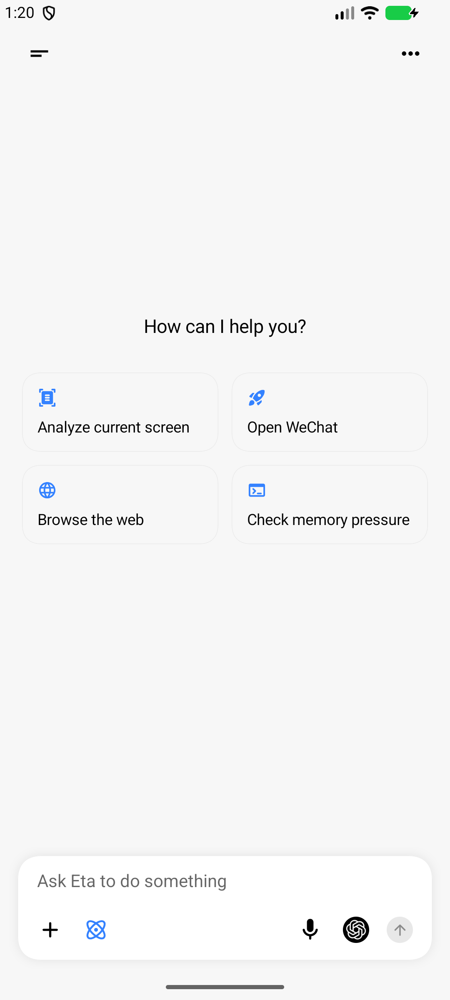
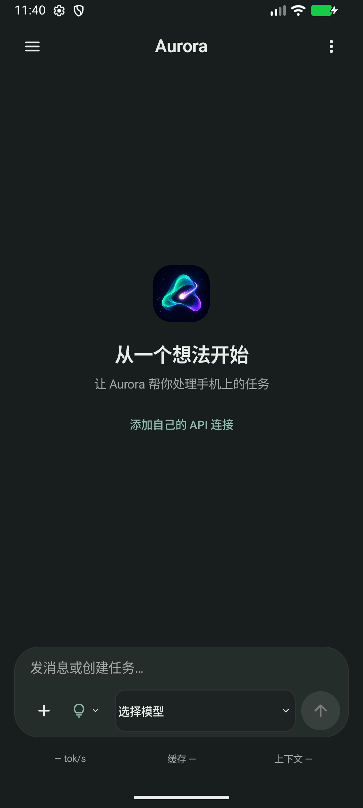

# Eta 与 Aurora 界面审阅

审阅日期：2026-10-16。Eta 官方最新发布为 [v3.3.1](https://github.com/Mangi-11/Eta/releases/tag/v3.3.1)，发布时间 2026-10-14。以实际安装 APK 的页面为依据，参考交互与信息组织，Aurora 实现独立编写。

## 覆盖与边界

在 API 37 模拟器实际打开 Eta 的主页、会话菜单、抽屉、浏览器、终端与会话管理、后台任务、设置、供应商编辑、models.dev 目录、记忆、Skills、MCP 编辑、角色、完整工具目录、工具说明、外观、颜色风格、强调色、缩放、语音、备份、权限、Root 状态、Linux、文件、附件菜单、思考等级。工具目录滚动至底部。没有安装 Linux、执行终端命令、提供密钥、发送付费请求或授权读取个人数据。

Eta 主输入框的模型控件点击后未打开选择器，不能把主页截图当成模型选择器验收。未安装 Linux 时的执行模式未能切换。观察到页面不代表对应后端已验证。

Aurora 逐项打开主页、会话菜单、模型选择、供应商与自定义连接表单、抽屉、设置、Root 状态、执行环境、工具说明、三类文件空间、外观、配色、自定义颜色、Skills 入口、浏览器及代理。未使用真实模型或 Root 执行操作。当前环境仅连接模拟器，0.1.4 真机验收待连接设备。

## 差距与处理

| 项目 | 实际观察 | 本轮处理 / 后续事项 |
| --- | --- | --- |
| 输入区 | Aurora 控件与信息密度需要重新平衡 | 按用户新参考改为圆角输入区，速度/缓存/上下文移至框外；模型保留家族图标、完整型号及思考等级 |
| 模型初次配置 | Aurora 无连接时仍显示大面积搜索和筛选空页 | 无连接时改为简短说明与添加入口 |
| 供应商编辑返回 | 添加连接与列表之间缺少清晰返回路径 | 增加返回供应商按钮和返回键处理；关闭仍退出整个面板 |
| 执行可读性 | 原始工具名和紧凑原始 JSON 难以观看 | 使用具体动作名称、进行中/返回错误/结果待核实；展开后显示调用 ID 和有界格式化结果 |
| 执行开销 | 为刷新步骤重复读取历史不必要 | 持久化后直接发送有界事件更新界面，保留最近 50 项；不因流式文本重复解析工具结果 |
| 能力入口 | Eta 对工具、权限、Linux、后台任务有独立页面；Aurora 部分入口仍是说明占位 | 后续优先做真实能力状态、执行与恢复，再扩展系统工具；不能用装饰页面宣称已完成 |
| Skills | Eta 有导入和管理；Aurora 当前只打开只读资源目录 | 安装、校验、运行与回滚仍未实现 |
| 终端/后台 | Eta 有终端会话和后台任务页；Aurora 尚无对应完整后端 | 需完成原生执行生命周期与取消/恢复，再做可观看终端和任务页 |
| 回复内容 | Aurora 仍为纯文本 | Markdown、代码块与消息操作是后续重点，需避免流式重排和滚动打断 |
| 缓存与性能 | 本轮没有真实供应商或基准数据 | 不宣称最高命中或性能领先；按协议、精确模型和实际路由继续验证 |

## 后续顺序

1. 验收输入框、指标详情、空模型页、供应商返回与执行记录；保留实际截图。
2. 将占位能力入口改为准确的可用状态与任务详情，完善回复阅读与滚动。
3. 完成 Agent 原生执行、后台生命周期、Root 工具、Skills；按既有架构约定研究新底层选择。
4. 用真实模型任务与真机测量成功率、延迟、内存及缓存；与 UI 观察分开记录。

原始模拟器截图和 XML 保存在工作区 outputs/ui-comparison，含 Eta 约 40 个命名页面与工具目录滚动记录。未截图或受权限/配置阻挡的功能不计作通过。随仓库保存的图片仅来自无密钥模拟器。

## 实际截图

| Eta 主页 | Aurora 深色主页（0.1.4） |
| --- | --- |
|  |  |

[浅色主页](assets/ui-audit/aurora-23-main-after.png) · [就地指标详情](assets/ui-audit/aurora-24-speed-after.png) · [无连接模型页](assets/ui-audit/aurora-25-model-empty-after.png) · [Eta 设置](assets/ui-audit/eta-09-settings.png) · [Eta Root 状态](assets/ui-audit/eta-34-root-status.png)

本轮验证：核心 45 项；API 37 模拟器普通 18 项与独立进程恢复 1 项通过，新增断言覆盖工具事件开始/完成顺序、预览上限和完整结果持久化。debug/release/lint 构建通过。供应商返回按钮与系统返回键均返回供应商列表。0.1.4 尚未进行真机和真实付费模型测试。
